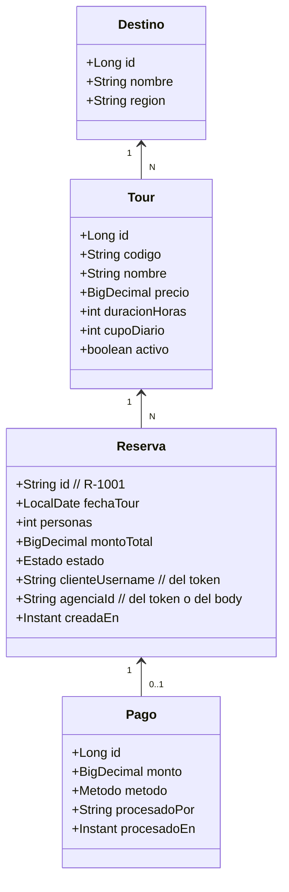
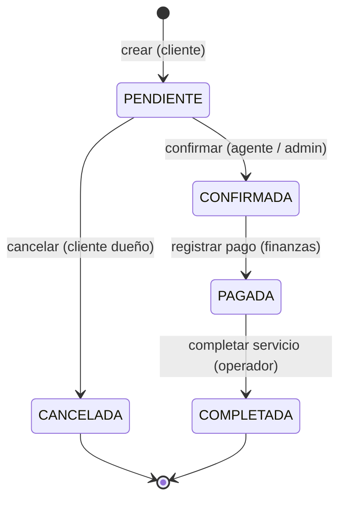
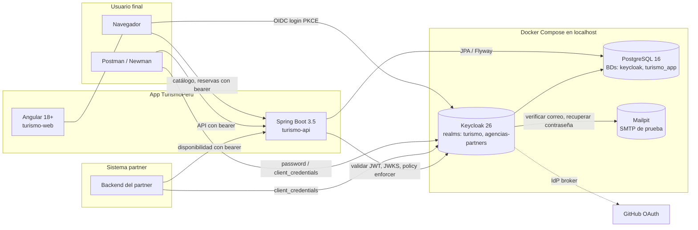
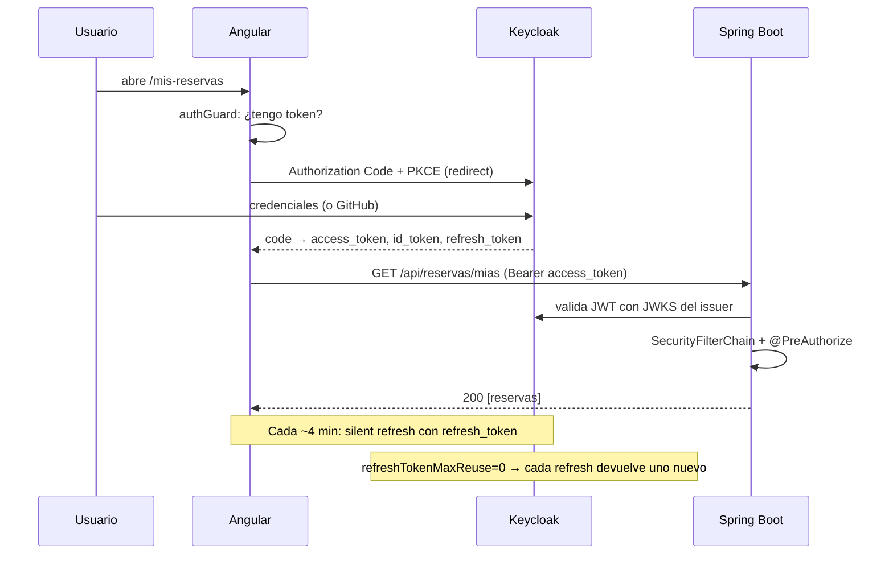

# DEFINICION.md — TurismoPerú Reservas · Definición funcional y arquitectura

Documento de contexto para entender **qué** hace el sistema y **cómo** está construido, antes de implementarlo. Complementa a `PLAN.md` (plan de ejecución) y `CLAUDE.md` (reglas para Claude Code).

---

## 1. El caso en una frase
**TurismoPerú** es una plataforma donde personas reservan tours en Perú, agencias aliadas gestionan y confirman esas reservas, Finanzas cobra, Operaciones administra el catálogo, y agencias externas (B2B) consultan disponibilidad desde sus propios sistemas. El trabajo del curso consiste en **asegurar** esa plataforma con Keycloak.

## 2. Por qué este caso
- Tiene **actores claramente distintos** (cliente, agente, supervisor, operador, finanzas, admin, partner), lo que permite demostrar roles, grupos y subgrupos.
- Tiene un **proceso de negocio con estados** (una reserva pasa por varias etapas con dueños distintos), lo que justifica usar `@PreAuthorize` y `@PostAuthorize`.
- Tiene **recursos con dueño** (una reserva pertenece a un cliente y a una agencia), lo que justifica la seguridad por recurso y la seguridad granular con Keycloak Authorization Services.
- Tiene **dos audiencias naturales** (operación interna y partners B2B), lo que justifica los **dos realms** que pide la rúbrica.
- Es un caso **realista para el Perú** y encaja con el entorno del alumno.

## 3. Alcance

### Dentro del alcance (lo que se construye)
- Catálogo de tours y destinos.
- Reserva de un tour por un cliente.
- Confirmación por una agencia.
- Cobro por Finanzas.
- Cierre del servicio por Operaciones.
- Cancelación por el cliente (mientras esté pendiente).
- Portal de agencias partners con consulta de disponibilidad.
- Reportes de ventas y pagos, con control de acceso granular por horario y por grupo.
- Login social con GitHub, para onboarding rápido de clientes.

### Fuera del alcance (simplificaciones conscientes)
- Pasarela de pago real: `POST /api/pagos` registra el pago, pero no cobra. El flujo de pago queda modelado, no transaccional.
- Facturación electrónica y boletas (SUNAT).
- Notificaciones por correo o WhatsApp (más allá de la verificación de email que trae Keycloak).
- Logística real del tour (guías, buses, cupos por horario).
- Multi-moneda. Todo en PEN.
- Multi-idioma de la aplicación. La UI está en español; Keycloak sí tiene `es` y `en`.

El objetivo es **demostrar seguridad**, no construir una plataforma turística completa.

## 4. Actores y lo que cada uno puede hacer

| Actor | Representado por | Puede |
|---|---|---|
| Cliente final | `ana.cliente` (estándar), `carlos.premium` | Ver catálogo, reservar, ver y cancelar sus reservas, pagar en línea (en una versión futura) |
| Agente de agencia | `lucia` (Lima), `mario` (Cusco) | Ver y confirmar las reservas **de su agencia** |
| Supervisor de agencia | `jorge` (Lima) | Lo mismo que un agente, más ver reportes de ventas y exportarlos (en horario laboral) |
| Operador | `olga` | Administrar el catálogo de tours y marcar servicios como completados |
| Finanzas | `fiona` | Registrar pagos, ver reporte de ventas y de pagos |
| Admin | `admin.turismo` | Todo lo anterior, más administración de Keycloak |
| Partner B2B (persona) | `pedro`, `sofia`, `rosa` | Entrar al portal de partners y consultar disponibilidad |
| Partner B2B (sistema) | Service account `partners-integracion` | Consultar disponibilidad desde un backend ajeno |
| Visitante | sin cuenta | Ver el catálogo público; iniciar un registro |

El detalle completo con grupos y asignación de roles vive en `PLAN.md` §1.5–1.7.

## 5. Historias de usuario (de dónde salen los endpoints)

1. **Visitante → cliente.** "Quiero ver qué tours ofrecen y, si me gusta uno, crear una cuenta y reservarlo." → E1, E2, registro, E4.
2. **Cliente reserva.** "Quiero reservar el tour a Machu Picchu para el 15 de noviembre, 2 personas." → E4.
3. **Cliente ve y cancela.** "Quiero ver mis reservas y cancelar la que aún no me confirmaron." → E3, E5, E6.
4. **Agente confirma.** "Me entra una reserva nueva de mi agencia; la confirmo si hay cupo." → E7, E8.
5. **Supervisor revisa.** "Al cierre de semana reviso las ventas de mi agencia y las exporto para el reporte interno." → E12, E13.
6. **Finanzas cobra.** "Registro el pago de la reserva confirmada." → E5, E11.
7. **Operaciones.** "Agrego o modifico un tour del catálogo." → E9, E10.
8. **Admin.** "Puedo intervenir en cualquier reserva." → cualquiera.
9. **Partner B2B.** "Desde mi plataforma consulto si hay cupos para el tour X el día Y." → E14.
10. **Login social.** "No quiero crear otra contraseña: entro con mi cuenta de GitHub." → IdP GitHub.

Cada historia tiene su fila en la **Matriz de pruebas** (`PLAN.md` §3) con el código HTTP esperado por usuario.

## 6. Modelo del dominio

`estado ∈ {PENDIENTE, CONFIRMADA, PAGADA, COMPLETADA, CANCELADA}`
`metodo ∈ {TARJETA, YAPE, TRANSFERENCIA}`

## 7. Máquina de estados de la reserva

Reglas:
- Una transición no permitida devuelve **409 Conflict** con un mensaje en español ("La reserva no está PENDIENTE y no puede cancelarse").
- La **autorización** se evalúa antes que el estado. Un usuario sin permiso recibe 403 aunque la transición sea inválida. Esto evita filtrar información del estado a usuarios no autorizados.

## 8. Modelo de seguridad resumido
| Pregunta | Respuesta |
|---|---|
| ¿Quién eres? | Keycloak autentica. Dos realms: `turismo` (operación interna) y `agencias-partners` (B2B) |
| ¿Qué puedes hacer en principio? | Un **rol** de realm o de cliente, heredado del **grupo** al que perteneces |
| ¿Qué puede pedir la aplicación por ti? | Un **scope** OpenID Connect. La API exige scopes en endpoints sensibles (`reservas:write`, `pagos:write`, `reportes:read`) |
| ¿Qué puedes hacer sobre **este** recurso concreto? | Reglas de dueño y agencia, resueltas con `@PreAuthorize`/`@PostAuthorize` leyendo `preferred_username` y el claim `agencia_id` del token |
| ¿Qué puedes hacer en los **reportes**? | Lo decide **Keycloak** vía Authorization Services (recurso + scope + policy + permission), incluida una **time policy** para el horario laboral |

El detalle con nombres exactos vive en `PLAN.md` §1.

## 9. Arquitectura de componentes

**Despliegue:** todo corre en la laptop con Docker Compose. Backend y frontend se ejecutan en el host (no en contenedores) para iterar más rápido. Keycloak, Postgres y Mailpit sí van en Docker.

## 10. Flujo de autenticación OIDC (resumen)

## 11. Decisiones y por qué
| Decisión | Alternativa | Motivo |
|---|---|---|
| Dos realms | Un realm con "realm roles" para B2B | El enunciado pide 2+ realms. B2B tiene identidades independientes |
| PostgreSQL | H2, MySQL | El enunciado prefiere BD persistente |
| `ddl-auto=update` + `data.sql` | Flyway | Flyway no suma a la rúbrica. Para una demo, el enfoque simple basta |
| Sin Swagger | Swagger UI | No lo pide la rúbrica. Postman cubre la verificación |
| 4 clientes, 2 por realm | Un cliente separado para Postman | `turismo-web` con direct grants ON en dev vale para ambos usos |
| PKCE para Angular | Implicit flow | Implicit está deprecado |
| JWT bearer en la API | Opaque + introspección | JWT es stateless y simple de validar con JWKS |
| `@PostAuthorize` para el detalle de la reserva | Filtrado en el servicio | Demuestra el patrón y produce 403 claro |
| Policy Enforcer solo en `/api/reportes/**` | En toda la API | Simplicidad donde no hace falta; granular donde el valor es claro |
| Multi-issuer en el backend | Dos APIs separadas | Reutilizar la misma API para operación interna y B2B justifica tener 2 realms funcionales |
| Angular standalone + `keycloak-angular` | `oidc-client-ts` directo | Canónico con Keycloak |

## 12. Supuestos
- La demo corre en la laptop del alumno. No se despliega en la nube.
- El tiempo de la máquina está en zona `America/Lima`, igual que Keycloak y el backend. Las policies de horario dependen de esto.
- GitHub OAuth es suficiente para demostrar login social; no se requiere Google o LinkedIn.
- Las imágenes de los tours son de bancos libres (Unsplash o Pexels) con atribución en el README.

## 13. Mapa con la rúbrica (resumen)
Cada componente de la rúbrica se refleja en algo concreto del caso:

| Rúbrica | Dónde se ve en el caso |
|---|---|
| 1 Instalación | Docker Compose con Keycloak + PostgreSQL |
| 2 Configuración | Dos realms, cuatro clientes, roles de realm y de cliente, client scopes, grupos y subgrupos con atributos, 10 usuarios de prueba |
| 3 API y RACI | 14 endpoints clasificados en público, privado, especial y granular, con una matriz RACI |
| 4 SecurityFilterChain | Reglas por ruta leídas de `application.yml`, más `@PreAuthorize`/`@PostAuthorize` |
| 5 Angular y RACI | 10 rutas con guards, directivas por rol y matriz RACI de pantallas |
| 6 Seguridad granular | Recursos, scopes, policies (rol, grupo, horario, usuario, agregada) y permissions en el cliente `turismo-api` |
| 7 Social login | GitHub como IdP, con mapper al grupo `Clientes/Estandar` |
| 8 Tema UI | Tema `turismo-peru` con logo, colores, mensajes en español |
| 9 Configuración | Español, política de contraseña, tiempos de token y de sesión, reutilización controlada |
| 10 Otros | MFA, verificación de email, fuerza bruta, auditoría, B2B |

---

## ¿Qué más podría elaborar?
Lo pongo en orden de utilidad real. **Dígame cuáles incluyo** (se agregan al PLAN.md o van en archivos propios).

1. **Mock-ups de pantallas (ASCII o Mermaid).** Una vista rápida de cada pantalla del frontend: catálogo, mis reservas, panel de agencia, reportes. Ayuda cuando Claude Code arme los componentes. *(Me inclino por sí.)*
2. **Diccionario de datos / DDL inicial.** Las tablas con columnas, tipos y relaciones, lista para que Flyway las use. *(Me inclino por sí; evita que Claude Code improvise nombres.)*
3. **Glosario funcional.** Qué es un tour, un cupo, una agencia, un partner. Útil si otro profesor o alumno lee el repositorio.
4. **Contratos OpenAPI de los 20 endpoints** (request, response, errores). Ya se generan con Swagger, pero tenerlos predefinidos acelera la Fase 4.
5. **Matriz de amenazas (STRIDE abreviada).** Qué ataque mitiga cada medida (CSRF, token theft, enumeración, etc.). Suma valor en la sustentación.
6. **Plan de sustentación oral.** Guión de 10 a 15 minutos: qué mostrar en vivo, en qué orden, qué comandos tener listos, qué preguntas anticipar del docente.
7. **Checklist de salud previa a entregar.** Lista corta tipo "comprobar antes de grabar el video o sustentar".
8. **Diagrama de clases del backend** (controllers, services, security beans). Útil si quiere revisar que la arquitectura hexagonal esté bien aplicada.

Dígame cuáles agrego.
