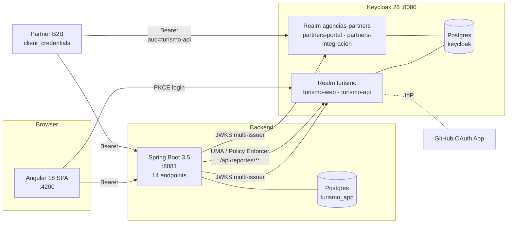

# keycloak-turismo

Trabajo final del curso **Security with Keycloak** (Galaxy).

API y portal web de reservas turísticas (TurismoPerú) con autenticación
y autorización completas sobre Keycloak 26 + Spring Security + OAuth 2
+ Angular. Dos realms, cuatro clientes, catorce endpoints, seguridad
granular (UMA), login federado con GitHub, tema de UI propio,
auditoría, brute-force detection y colección Postman reproducible.

---

## Arquitectura



Entidades, matriz RACI y detalle de los endpoints en
[`docs/`](docs/).

---

## Requisitos

| Herramienta | Versión mínima |
|---|---|
| Docker Engine | 24.x con Compose v2 |
| JDK | 21 (OpenJDK) |
| Maven | 3.9+ |
| Node.js | 20+ (con npm) |
| Angular CLI | 18+ |
| Newman | 6.x (`npx newman` sirve) |

Puertos ocupados en localhost: **4200** (frontend), **8080** y
**9000** (Keycloak), **8081** (backend), **5433** (Postgres).

---

## Ejecución en 5 pasos

```bash
# 1) Clonar y preparar entorno
git clone https://github.com/miltonvasquezpari/keycloak-turismo.git
cd keycloak-turismo
cp .env.example .env     # ajustar GITHUB_CLIENT_ID/SECRET si se usa F7

# 2) Levantar Keycloak + Postgres (importa los realms en el 1er boot)
docker compose up -d

# 3) Backend Spring Boot
cd backend && mvn spring-boot:run &

# 4) Frontend Angular
cd ../frontend && npm install && npm start

# 5) Verificar con Postman / Newman
cd ..
newman run postman/TurismoPeru-Keycloak.postman_collection.json \
  -e postman/local.postman_environment.json \
  --env-var "partners_integracion_secret=$(grep PARTNERS_INTEGRACION_SECRET .env | cut -d= -f2)" \
  -r cli,htmlextra --reporter-htmlextra-export docs/evidencias/newman.html
```

Resultado esperado: **54 asserts verdes, 0 rojos**.

Reset limpio (si el estado de reservas quedó inconsistente entre
corridas):

```bash
docker compose down -v && docker compose up -d
```

---

## URLs

| Qué | URL |
|---|---|
| Frontend Angular | <http://localhost:4200> |
| Backend Spring | <http://localhost:8081/api/public/tours> |
| Admin Console Keycloak | <http://localhost:8080/admin/master/console/> |
| Realm turismo | <http://localhost:8080/realms/turismo/> |
| Realm partners | <http://localhost:8080/realms/agencias-partners/> |
| Admin KC bootstrap | `admin` / `admin` (ver `.env`) |

---

## Usuarios de prueba

Contraseña única: **`Turismo#2026a`** (no temporal, email verificado).

| Usuario | Realm | Grupo / rol | Para probar |
|---|---|---|---|
| `ana.cliente` | turismo | Clientes/Estandar · `cliente` | E3 E4 E5 E6 |
| `carlos.premium` | turismo | Clientes/Premium · `cliente` | E5 dueño |
| `lucia.agente` | turismo | Agencias/Lima/Ventas · `agente` (LIM01) | E7 E8 |
| `mario.agente` | turismo | Agencias/Cusco/Ventas · `agente` (CUS01) | E7 E8 cross-agency |
| `jorge.supervisor` | turismo | Agencias/Lima/Supervision | E12 |
| `olga.operador` | turismo | Operaciones/Catalogo · `operador` | E9 E10 |
| `fiona.finanzas` | turismo | Operaciones/Finanzas · `pagos.procesar`, `reportes.ver` | E11 (necesita scope `pagos:write`) |
| `admin.turismo` | turismo | Administracion · `admin` | E12 E13 |
| `pedro.partner` | agencias-partners | Partners/Nacionales/Arequipa-Tours | E14 |
| `rosa.partner` | agencias-partners | Partners-Admin | E14 |
| `test.bruteforce` | turismo | Clientes/Estandar | Fase 9 (demo lockout) |

Service account:
`partners-integracion` (realm `agencias-partners`) por
`client_credentials` → `E14`.

---

## Rúbrica → evidencia

Las 10 componentes del enunciado, con el archivo o captura que
demuestra su cumplimiento.

| # | Componente | Cumplimiento | Evidencia |
|---|---|---|---|
| 1 | Keycloak (Instalación) con BD persistente | Docker Compose con Keycloak 26 + Postgres 16, datos sobreviven a `restart` | [`docker-compose.yml`](docker-compose.yml) |
| 2 | 2 realms con clientes, usuarios, grupos y subgrupos, roles y alcances; roles y alcances también a nivel de cliente | `turismo` + `agencias-partners`; 4 clientes; grupos jerárquicos con atributos (`agencia_id`) | [`keycloak/realms/`](keycloak/realms/) · [`docs/09-configuracion-realm.md`](docs/09-configuracion-realm.md) |
| 3 | APIs REST con diagrama, accesos público/privado/especial, matriz RACI | 14 endpoints E1..E14 (`permitAll`, por rol/scope, `@PreAuthorize`/`@PostAuthorize`) | [`docs/02-api-diagrama.md`](docs/02-api-diagrama.md) · [`docs/04-raci-backend.md`](docs/04-raci-backend.md) · [`backend/src/main/java/pe/turismo/api/web/`](backend/src/main/java/pe/turismo/api/web/) |
| 4 | Spring Security con `SecurityFilterChain`, `@PreAuthorize`, constantes/properties | Reglas por ruta y rol/scope en `application.yml` + `SecurityConstants` + method security | [`backend/src/main/java/pe/turismo/api/security/`](backend/src/main/java/pe/turismo/api/security/) · [`backend/src/main/resources/application.yml`](backend/src/main/resources/application.yml) |
| 5 | App Web con diagrama + matriz RACI | SPA Angular 18 standalone, interceptor bearer, guards por rol, directiva `*tieneRol` | [`docs/03-web-diagrama.md`](docs/03-web-diagrama.md) · [`docs/05-raci-frontend.md`](docs/05-raci-frontend.md) · [`docs/06-frontend-qa.md`](docs/06-frontend-qa.md) |
| 6 | Seguridad Granular (Scopes/Resources/Policy/Permission) | Keycloak Authorization Services en `turismo-api` para `/api/reportes/**` (recurso "Reporte Ventas", scopes `view`/`export`, policy de horario) | [`docs/06-seguridad-granular.md`](docs/06-seguridad-granular.md) · [`backend/src/main/java/pe/turismo/api/security/ReportesSecurityConfig.java`](backend/src/main/java/pe/turismo/api/security/ReportesSecurityConfig.java) · [`docs/evidencias/fase5-*.txt`](docs/evidencias/) |
| 7 | Social Login (GitHub) | IdP `github` en realm `turismo` con hardcoded group `/Clientes/Estandar` y atributo `origen=github` | [`docs/07-github-idp.md`](docs/07-github-idp.md) · bloque `identityProviders` en [`keycloak/realms/turismo-realm.json`](keycloak/realms/turismo-realm.json) |
| 8 | Tema personalizado | `turismo-peru/login/` con CSS, logo chakana SVG, messages ES/EN; password policy con mensaje custom | [`docs/08-tema-ui.md`](docs/08-tema-ui.md) · [`keycloak/themes/turismo-peru/`](keycloak/themes/turismo-peru/) |
| 9 | Español + policy de contraseña + duración tokens + reutilización | `defaultLocale=es`, policy `length(10)+upper(1)+lower(1)+digit(1)+regex(@%&#.+/!=?¿)+history(3)+notUsername`, access 5 min / refresh 30 min, `refreshTokenMaxReuse=0` | [`docs/09-configuracion-realm.md`](docs/09-configuracion-realm.md) |
| 10 | Otros (valor agregado) | Auditoría de 14 tipos de eventos; brute force 5 fallos/60–900s; service account B2B para E14 | [`docs/10-valor-agregado.md`](docs/10-valor-agregado.md) · [`docs/evidencias/fase9-*.txt`](docs/evidencias/) |

Reporte Newman: [`docs/evidencias/newman.html`](docs/evidencias/newman.html).

---

## "Número de veces a reutilizar" (ambas lecturas)

El enunciado pide configurar un **número de veces a reutilizar**
tokens. En Keycloak hay dos interpretaciones distintas y las dos están
cubiertas:

**(a) Reutilización del refresh token** — en Realm settings → Sessions / Tokens:
- `revokeRefreshToken = true`
- `refreshTokenMaxReuse = 0`

Significa: cada vez que se usa un refresh token para pedir un access
token nuevo, Keycloak **rota el refresh** y marca el anterior como
inválido. Si una app usa el refresh token viejo (porque alguien se lo
robó y lo intenta usar en paralelo), responde `invalid_grant`. En
Postman la carpeta 01 incluye un request "Refresh token - ana (ok)"
que valida este flujo.

**(b) Número de usos de la decisión de autorización (Policy Enforcer)** —
en el recurso "Reporte Ventas" del cliente `turismo-api`, la política
"Horario Comercial" tiene `decisionStrategy=AFFIRMATIVE` y la decisión
NO se cachea (`cache-decisions` deshabilitado en el enforcer). Cada
request a `/api/reportes/**` consulta Keycloak y la decisión aplica
una sola vez; no hay reutilización de una respuesta UMA previa.

Resumen: **rotación de refresh (sesión) + decisión fresca por request
(autorización)**.

---

## Seguridad y secretos

- `.env` **no versionado** (`cambiar-en-local` como placeholder en
  `.env.example`). Los JSON de realm referencian secretos con
  `${TURISMO_API_SECRET}`, `${PARTNERS_INTEGRACION_SECRET}`,
  `${GITHUB_CLIENT_ID}`, `${GITHUB_CLIENT_SECRET}`, resueltos por
  Keycloak al importar.
- Verificación: `git grep -E 'Ov23li|clientSecret.*[0-9a-f]{30}'`
  debe no devolver nada.
- `turismo-web` y `partners-portal` tienen `directAccessGrantsEnabled`
  **solo para desarrollo** (lo usa Newman en password grant); en
  producción se desactivaría.

---

## Prueba de humo

Para validar entrega: clonar el repo en otra carpeta y seguir
*Ejecución en 5 pasos*. Al final, el reporte Newman debe salir con
**54 asserts verdes**.

---

## Mapa de documentación

```
docs/
├── 01-modelo-dominio.md     entidades + maquina de estados
├── 02-api-diagrama.md       14 endpoints agrupados por tipo
├── 03-web-diagrama.md       rutas Angular + PKCE
├── 04-raci-backend.md       matriz RACI backend
├── 05-raci-frontend.md      matriz RACI frontend
├── 06-frontend-qa.md        QA en navegador F6
├── 06-seguridad-granular.md UMA, policies, scopes F5
├── 07-github-idp.md         IdP GitHub F7
├── 08-tema-ui.md            tema turismo-peru F8
├── 09-configuracion-realm.md  passwords, locale, tokens, eventos F2/F9
├── 10-valor-agregado.md     3 features F9
└── evidencias/              newman.html, horario.txt, matriz.txt, etc.
```
