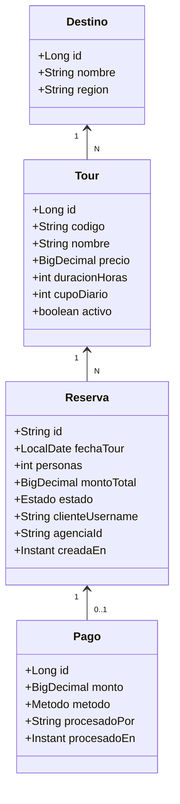
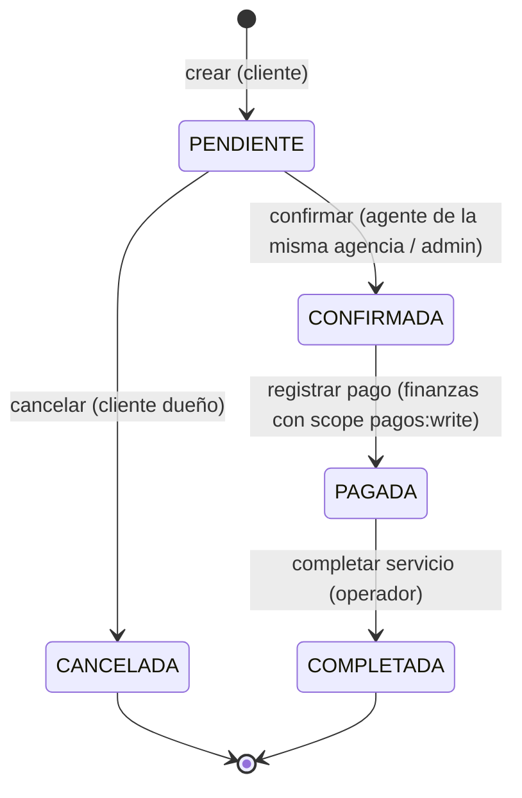

# 01 · Modelo de dominio

## Clases

**Enumeraciones**
- `Estado` ∈ { PENDIENTE, CONFIRMADA, PAGADA, COMPLETADA, CANCELADA }
- `Metodo` ∈ { TARJETA, YAPE, TRANSFERENCIA }

**Notas**
- `id` de reserva es textual, formato `R-NNNN` (facilita las pruebas de Postman y la matriz §3 del PLAN).
- `clienteUsername` y `agenciaId` NO vienen del body; se extraen del JWT (claim `preferred_username` y claim `agencia_id` respectivamente). Esto evita que un atacante reserve a nombre de otro.

## Máquina de estados de la reserva

**Reglas de evaluación (importante para la seguridad)**
1. Primero se evalúa **autorización** (rol + scope + regla sobre el recurso).
2. Solo si el usuario puede operar, se evalúa el **estado**.
3. Transición inválida → `HTTP 409 Conflict` con mensaje en español (p.ej. `"La reserva no está PENDIENTE y no puede cancelarse"`).

Este orden evita filtrar información del estado a usuarios no autorizados: un no-dueño que intente cancelar recibe `403`, nunca `409`.

## Datos semilla (los que carga `data.sql` en Fase 4)

**5 destinos:** Cusco, Ica, Arequipa, Puno, La Libertad.

**6 tours:** Machu Picchu, Valle Sagrado, Montaña 7 Colores, Islas Ballestas + Huacachina, Colca 2D/1N, Chan Chan.

**4 reservas:**

| Id      | Cliente         | Tour          | Agencia | Estado      |
|---------|-----------------|---------------|---------|-------------|
| R-1001  | carlos.premium  | Machu Picchu  | LIM01   | PENDIENTE   |
| R-1002  | ana.cliente     | Valle Sagrado | CUS01   | PENDIENTE   |
| R-1003  | ana.cliente     | Chan Chan     | LIM01   | CONFIRMADA  |
| R-1004  | carlos.premium  | Colca         | CUS01   | PAGADA      |

Esta mezcla cubre los casos de prueba de §3 del PLAN: cliente dueño vs. no dueño; agente de LIM01 vs. CUS01; reserva en cada estado relevante para probar transiciones válidas e inválidas.
