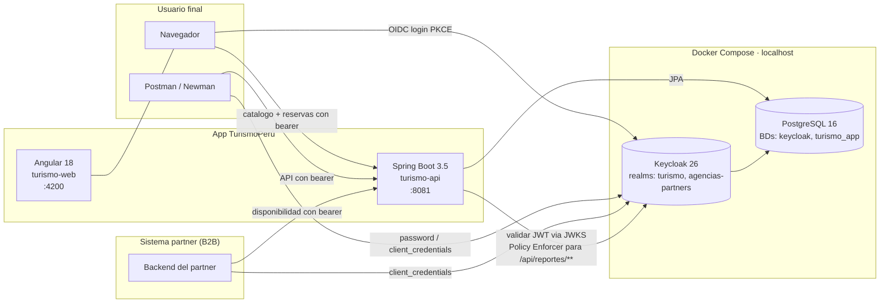
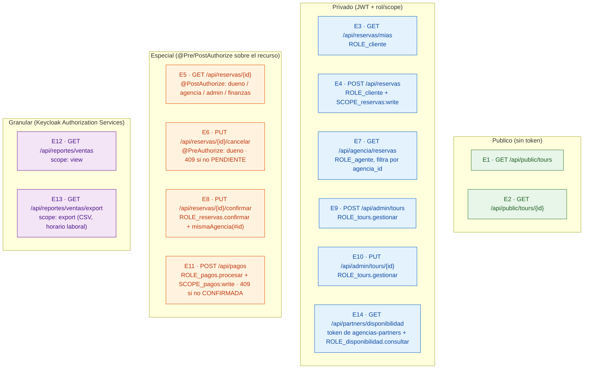
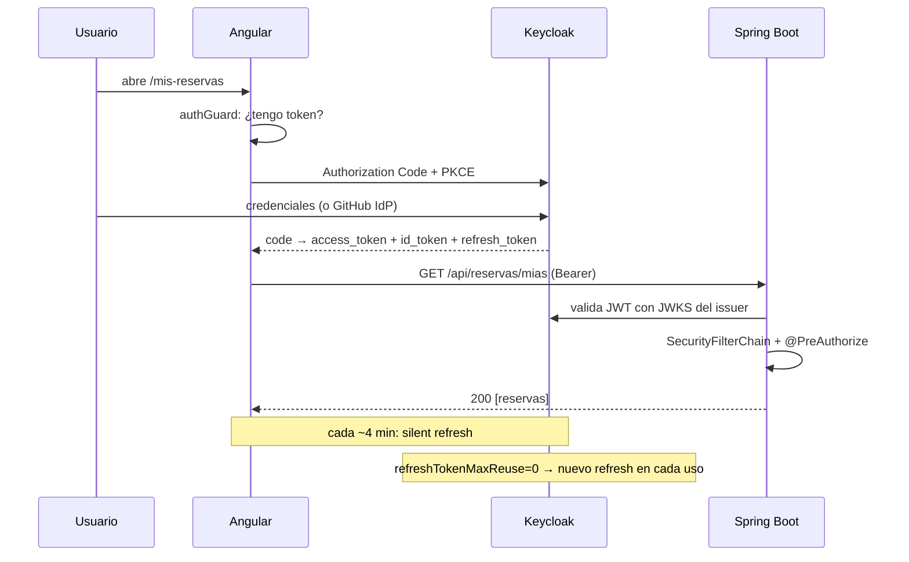

# 02 · Diagrama de la API

## Arquitectura de componentes

**Puntos clave**
- La API **nunca** valida contraseñas; valida JWTs firmados por Keycloak usando JWKS.
- La API acepta tokens de **dos issuers** (multi-realm): `turismo` para la operación interna y `agencias-partners` para B2B. Resolución por `JwtIssuerAuthenticationManagerResolver`.
- Audience `turismo-api` requerida en cada token (mapper en el scope dedicado del cliente — T13).
- `/api/reportes/**` tiene un `SecurityFilterChain` propio (`@Order(1)`) que delega la decisión a Keycloak Authorization Services via `ServletPolicyEnforcerFilter`.

## Mapa de los 14 endpoints

## Cuadro de reglas por endpoint

| #  | Metodo + ruta                              | Tipo       | Rol / Scope / Regla                                                   |
|----|--------------------------------------------|------------|-----------------------------------------------------------------------|
| E1 | GET  `/api/public/tours`                   | Publico    | `permitAll`                                                           |
| E2 | GET  `/api/public/tours/{id}`              | Publico    | `permitAll`                                                           |
| E3 | GET  `/api/reservas/mias`                  | Privado    | `ROLE_cliente`                                                        |
| E4 | POST `/api/reservas`                       | Privado    | `ROLE_cliente` AND `SCOPE_reservas:write`                             |
| E5 | GET  `/api/reservas/{id}`                  | Especial   | `@PostAuthorize`: dueno / agente de la misma agencia / admin / finanzas |
| E6 | PUT  `/api/reservas/{id}/cancelar`         | Especial   | `@PreAuthorize("hasRole('cliente') and @reservaSecurity.esDueno(#id,auth)")` · 409 si no PENDIENTE |
| E7 | GET  `/api/agencia/reservas`               | Privado    | `ROLE_agente` (filtra por `agencia_id` del token)                     |
| E8 | PUT  `/api/reservas/{id}/confirmar`        | Especial   | `ROLE_reservas.confirmar` AND (admin OR `@reservaSecurity.mismaAgencia(#id,auth)`) |
| E9 | POST `/api/admin/tours`                    | Privado    | `ROLE_tours.gestionar`                                                |
| E10| PUT  `/api/admin/tours/{id}`               | Privado    | `ROLE_tours.gestionar`                                                |
| E11| POST `/api/pagos`                          | Especial   | `ROLE_pagos.procesar` AND `SCOPE_pagos:write` · 409 si no CONFIRMADA  |
| E12| GET  `/api/reportes/ventas`                | Granular   | Policy Enforcer, scope `view`                                         |
| E13| GET  `/api/reportes/ventas/export`         | Granular   | Policy Enforcer, scope `export` (horario laboral L–S 08–20)            |
| E14| GET  `/api/partners/disponibilidad`        | Privado    | Token de realm `agencias-partners` + `ROLE_disponibilidad.consultar`  |

## Flujo OIDC (resumen)

