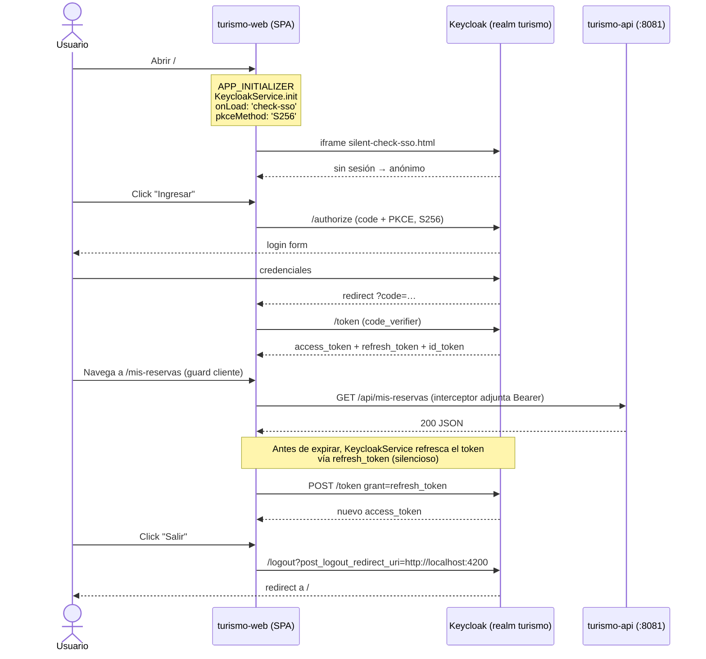

# Fase 6 · Frontend Angular — diagramas

## Árbol de rutas

```
/
├── /                       → CatalogoComponent          (público)              · E1
├── /tours/:id              → DetalleTourComponent       (público)              · E2
├── /reservar/:tourId       → ReservarComponent          (rol cliente)          · E4
├── /mis-reservas           → MisReservasComponent       (rol cliente)          · E3,E5,E6
├── /agencia                → AgenciaComponent           (rol agente + claim)   · E7,E8
├── /operaciones/tours      → OperacionesToursComponent  (rol tours.gestionar)  · E9,E10
├── /finanzas/pagos         → FinanzasPagosComponent     (rol pagos.procesar)   · E11
├── /reportes               → ReportesComponent          (autenticado)          · E12,E13
├── /acceso-denegado        → AccesoDenegadoComponent    (público, 403 amable)
└── **                      → redirige a /
```

Los *loadComponent* dinámicos crean *lazy chunks* por pantalla (ver salida de
`ng build`). Los guards viven en `src/app/core/role.guard.ts` y la directiva
estructural `*tieneRol` en `src/app/core/tiene-rol.directive.ts`.

## Secuencia de autenticación (PKCE S256 + check-sso)



## Interceptor

```
┌─────────────── HttpClient ───────────────┐
│                                          │
│  req.url empieza con http://localhost:8081/api                           
│      │
│      ├── sí, pero /api/public/*  → NO adjunta Authorization               
│      └── sí, resto /api/*        → adjunta Authorization: Bearer <token>  
│      └── no es /api              → pasa tal cual (Keycloak, estáticos)    
└──────────────────────────────────────────┘
```

Implementación: `src/app/core/auth.interceptor.ts`.

## Variables de configuración

Archivo `src/environments/environment.ts`:

| Clave | Valor dev |
|---|---|
| `apiBase` | `http://localhost:8081` |
| `keycloak.url` | `http://localhost:8080` |
| `keycloak.realm` | `turismo` |
| `keycloak.clientId` | `turismo-web` |

El `silent-check-sso.html` vive en `public/` (servido en `/silent-check-sso.html`).
