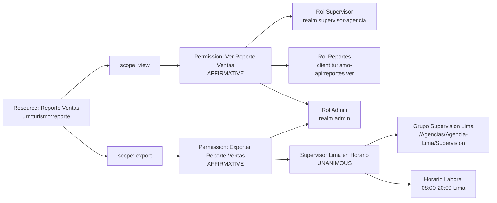

# Fase 5 · Seguridad granular (rúbrica 6)

Autorización fina sobre el cliente `turismo-api` del realm `turismo` usando
**Keycloak Authorization Services** + **Policy Enforcer** en el backend. Solo
el recurso `Reporte Ventas` está protegido. Dos scopes de autorización (`view`,
`export`), seis policies y dos permissions scope-based. Settings del Resource
Server en `ENFORCING` + `UNANIMOUS` (se borraron los *Default* del T4).

## 1. Settings

| Campo | Valor |
|---|---|
| Policy Enforcement Mode | ENFORCING |
| Decision Strategy | UNANIMOUS |
| Default Resource/Policy/Permission | **borrados** (T4) |

## 2. Authorization scopes

| Scope | Uso |
|---|---|
| `view` | Lectura del reporte (E12 JSON) |
| `export` | Descarga del CSV (E13) |

## 3. Resource

| Nombre | Tipo | URIs | Scopes |
|---|---|---|---|
| Reporte Ventas | `urn:turismo:reporte` | `/api/reportes/ventas`, `/api/reportes/ventas/*` | view, export |

## 4. Policies

| Nombre | Tipo | Definición |
|---|---|---|
| Rol Supervisor | Role | realm role `supervisor-agencia` |
| Rol Reportes | Role | client role `turismo-api:reportes.ver` |
| Rol Admin | Role | realm role `admin` |
| Grupo Supervision Lima | Group | `/Agencias/Agencia-Lima/Supervision` |
| Horario Laboral | Time | 08:00–20:00 hora Lima (TZ `America/Lima`, T5) |
| Supervisor Lima en Horario | Aggregated | *Grupo Supervision Lima* + *Horario Laboral* (UNANIMOUS) |

## 5. Permissions

| Nombre | Tipo | Scope | Policies | Decision Strategy |
|---|---|---|---|---|
| Ver Reporte Ventas | Scope-based | `view` | Rol Supervisor, Rol Reportes, Rol Admin | AFFIRMATIVE |
| Exportar Reporte Ventas | Scope-based | `export` | Supervisor Lima en Horario, Rol Admin | AFFIRMATIVE |

## 6. Diagrama recurso → scope → permiso → policies



## 7. Backend

- Dependencia `org.keycloak:keycloak-policy-enforcer` **igual al servidor**
  (26.0.7, T14).
- `ReportesSecurityConfig` registra un segundo `SecurityFilterChain`
  `@Order(1)` con `securityMatcher("/api/reportes/**")`:
  - JWT solo del realm `turismo` (único issuer confiable: un token de
    `agencias-partners` cae en 401 — ver matriz).
  - `ServletPolicyEnforcerFilter` registrado con `addFilterAfter(...,
    BearerTokenAuthenticationFilter.class)`.
- Configuración del enforcer construida **en código** desde
  `turismo.keycloak.*` (lee variables de entorno). Mapeo de rutas:
  - `GET /api/reportes/ventas` → scope `view`.
  - `GET /api/reportes/ventas/export` → scope `export`.

## 8. Endpoints

| ID | Verbo + ruta | Scope requerido |
|---|---|---|
| E12 | `GET /api/reportes/ventas` | `view` |
| E13 | `GET /api/reportes/ventas/export` | `export` (CSV con `Content-Disposition: attachment`) |

## 9. Matriz de pruebas (criterios de aceptación)

Resultado observado con `scripts/matriz.sh` (ver
`docs/evidencias/fase5-matriz.txt`). Hora de corrida: 21:47 Lima → fuera del
Horario Laboral.

| Usuario | `/api/reportes/ventas` (view) | `/api/reportes/ventas/export` (export) | Esperado por rúbrica |
|---|---|---|---|
| `ana.cliente` | 403 | 403 | 403 en ambos |
| `fiona.finanzas` | 200 | 403 | ve, no exporta |
| `jorge.supervisor` | 200 | 403 (fuera 08-20) · 200 (en horario) | ve siempre, exporta en horario |
| `admin.turismo` | 200 | 200 | ve y exporta siempre |
| partners realm (cross) | 401 | 401 | 401 (issuer no confiable) |

Prueba de la policy de tiempo (ver `fase5-horario-flip.txt`):

1. Hora de servidor fuera del rango → `jorge` export = 403.
2. Policy ampliada temporalmente a 00:00–23:59 → `jorge` export = 200.
3. Policy restaurada a 08:00–20:00 → `jorge` export = 403.

### Evidencia Evaluate (REST `/policy/evaluate`)

| Usuario | scope `view` | scope `export` | Archivo |
|---|---|---|---|
| `ana.cliente` | DENY | DENY | `fase5-evaluate-ana-*.txt` |
| `fiona.finanzas` | PERMIT | DENY | `fase5-evaluate-fiona-*.txt` |
| `jorge.supervisor` | PERMIT | DENY (fuera de horario) | `fase5-evaluate-jorge-*.txt` |
| `admin.turismo` | PERMIT | PERMIT | `fase5-evaluate-admin-*.txt` |

## 10. Postman (RPT)

Para obtener un RPT firmado contra el servidor de autorización:

```
POST /realms/turismo/protocol/openid-connect/token
grant_type=urn:ietf:params:oauth:grant-type:uma-ticket
audience=turismo-api
Authorization: Bearer <access_token del usuario>
```

El RPT devuelto incluye `permissions[].scopes` autorizados por Keycloak y el
enforcer lo acepta en lugar del access token normal.

## 11. Trampas aplicadas

- **T4**: borrados *Default Resource/Policy/Permission* para que `ENFORCING` no
  deje todo abierto por el default permit.
- **T5**: el contenedor Keycloak corre con `TZ=America/Lima`; la Time Policy
  usa esa hora, no UTC.
- **T14**: `keycloak-policy-enforcer` fijado a la misma versión del servidor
  (26.0.7).
